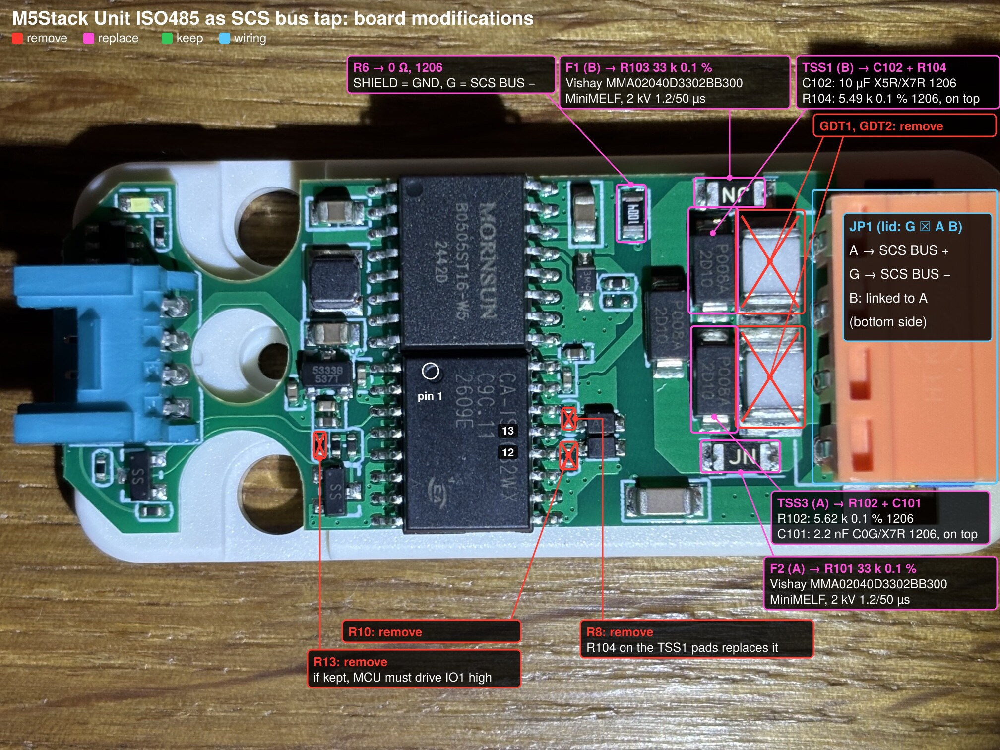

# Bticino SCS Bus Sniffer

Our building complex has an intercom from Bticino (Legrand).
Even though we were provisioned in 2021, we're on a proprietary, 2-wire bus called [SCS](https://en.wikipedia.org/wiki/Bus_SCS).
We are interested in logging some basic events, such as "which unit opened the garage door".

## Hardware

It looks like this is a job for F454, which has been EOL-ed by Legrand, so we have to build some simple bus sniffer.
I was lazy, so I decided to reuse some existing isolated RS-485 converter (even though SCS is very different from [RS-485](https://en.wikipedia.org/wiki/RS-485)).
This project adapts the M5Stack's RS485-ISO ([`U094`](https://docs.m5stack.com/en/unit/Unit_RS485-ISO)) for passive SCS sniffing.

SCS is a 27 V DC bus that carries power and data on the same two wires.
Data is UART-like (9600 Bd, 8N1), but a `0` bit is only a ~6 V dip lasting 34 µs at the start of the 104 µs bit cell; idle and `1` bits leave the bus alone.
The RS-485 receiver is just a differential comparator, so we feed its A/B inputs from two voltage dividers with slightly different ratios, one lightly filtered and one heavily filtered:

- `A` follows the bus quickly (33k/4.7k, τ ≈ 9 µs),
- `B` sits at a slightly lower ratio (36k/4.7k) behind a 10 µF capacitor, i.e., it tracks the average bus voltage over ~40 ms.

At idle, `A` is ~0.25 V above `B` and the receiver outputs high.
During a dip, `A` drops ~0.5 V below `B` and the output goes low.
The transceiver's isolation barrier and its isolated DC/DC converter keep the MCU galvanically separate from the bus, and the 33k/36k series resistors limit the load to ~1.5 mA, so the tap cannot disturb the bus even if the RS-485 driver gets enabled.
The MCU receives the raw 34 µs pulses on the Grove port and decodes them with the ESP32's RMT peripheral.
Polarity matters: SCS bus + goes to terminal A (linked to B), bus − to G.
A reversed connection damages nothing, but the tap receives nothing either.

The actual hardware modification is reasonably straightforward; the trickiest part is removing a few rather tiny 0402 resistors.
Also remove a few other, hand-soldering-friendly components, and place a bunch of 1206 SMD parts, which is a piece of cake:

- one 4k7 1% 1206 resistor (plus another one if R8 comes off by accident)
- one 33kΩ 1% MiniMELF resistor (SMM02040C3302FB300, or just a regular 1206 resistor if you do not care about surges)
- one 36kΩ 1% MiniMELF resistor (SMM02040C3602FB300, see above for alternatives)
- one 0Ω 1206 jumper
- one 10µF ≥16V X5R/X7R 1206 capacitor
- one 2.2nF C0G/X7R 1206 capacitor

Here are the SMD removals and replacements:

...and here is one tiny wire at the bottom:

Then, connect the positive end of the SCS bus to terminal A or B, and the negative terminal to GND/shield.

## Credits

This project was born out of frustration when a five-year-old building is already half-obsolete in 2026.
The actual SCS bus reverse engineering was done by many people, but I read mainly [the work of Michael Stapelberg](https://michael.stapelberg.ch/posts/2021-03-13-nuki-scs-series-overview/).
HW ideas and the RS-485 repurposing are mine, and the actual implementation was tremendously accelerated via use of Claude.
