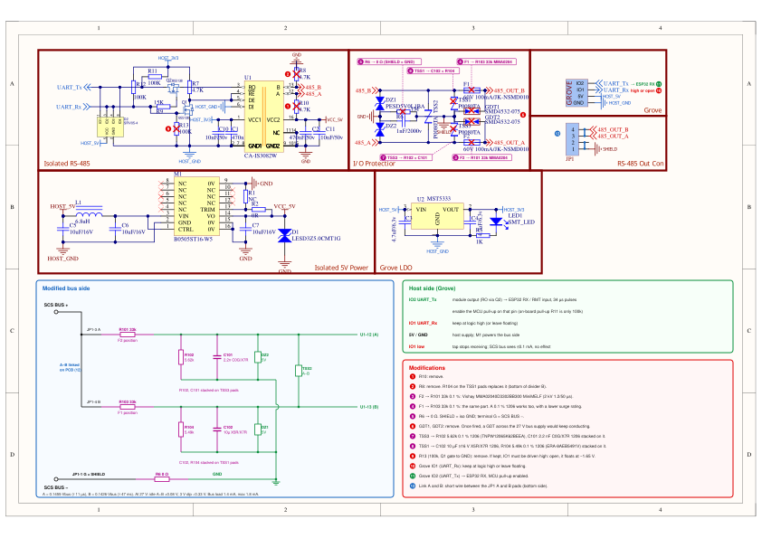

# Bticino SCS Bus Sniffer

Our building complex has an intercom from Bticino (Legrand).
Even though we were provisioned in 2021, we're on a proprietary, 2-wire bus called [SCS](https://en.wikipedia.org/wiki/Bus_SCS).
We are interested in logging some basic events, such as "which unit opened the garage door".
This does *not* capture the audio or video streams, and that's by design because we do not really want to stomp on people's privacy.
When deploying, keep in mind that even call metadata, door opening, etc, are typically [PII](https://en.wikipedia.org/wiki/Personal_data).

## Software

Everything is in [`sw/`](sw/):

- [`scs_decoder.h`](sw/scs_decoder.h): header-only C++20 decoder that turns pulse timings (e.g., from the ESP32's RMT) into bytes and validated `A8 ... A3` frames.
  Frames are 7 or 11 bytes long depending on their first payload byte; payload bytes can take any value, including `A3`.
- [`scs_protocol.h`](sw/scs_protocol.h): what a frame means, as far as it has been reverse-engineered: lighting/automation commands, state broadcasts, status requests, scenarios, door-entry rings and door lock release.
  Everything else is reported as `unknown`, with the raw bytes.
- [`scs_decoder_test.cpp`](sw/scs_decoder_test.cpp), [`scs_protocol_test.cpp`](sw/scs_protocol_test.cpp): tests, written as `static_assert`s; `make -C sw test` compiles them, so a successful build means they all passed.
- [`scs_esphome.h`](sw/scs_esphome.h) and [`scs-tap.yaml`](sw/scs-tap.yaml): an ESPHome snippet for the M5Stack Unit PoE-P4 ([`U213`](https://docs.m5stack.com/en/unit/Unit_PoE-P4), ESP32-P4).
  The tap's Grove `T↓R` pin goes to GPIO54, and the `R↑T` pin goes to GPIO53, which is held high.
  Every frame is logged (e.g., `A8 91 03 60 08 FA A3: ring flat 03`) and handed to an example lambda, as raw hex and as text; malformed captures, stray bytes and glitches are logged with the raw capture.
- [`scs-tap-poe-p4.yaml`](sw/scs-tap-poe-p4.yaml): a minimal complete device config for the U213 that includes the snippet.

### Reading the diagnostic log

A capture that did not decode cleanly is logged like this:

```
[W][scs:111]: capture: 0 frames, 0 errors [], 1 stray bytes, 1 glitches, 6 durations
[W][scs:114]: bytes: FE
[W][scs:089]: raw[0]: 13 -95 8 -995 5 -2000
```

- `capture:` counts what the decoder made of one capture: complete frames, errors (by name), bytes outside a frame (`A5` acknowledgements excluded), and glitches (pulses shorter than 8 µs, ignored).
- `bytes:` every byte decoded from the capture, in order, whether or not it ended up in a frame.
  A byte whose dips were missed reads as `1` bits, so a lone start bit decodes as `FF`.
- `raw[n]:` the capture as ESPHome's `remote_receiver` delivers it, 24 values per line, `n` being the index of the first one.
  Each value is the duration of one level in µs, and the levels alternate:
  positive = mark = the bus dipped (the tap's output was low), negative = space = the bus was idle.
  These are durations, not timestamps; a pulse starts at the sum of all values before it.
  A capture starts with the first mark and ends with the idle that closed it, which is reported as the `idle:` setting (`-2000`).
  The resolution is 1 µs; the RMT drops pulses shorter than `filter:` (2 µs) before they get here.

In the example, the start bit is a 13 µs pulse, the next pulse starts 108 µs (13 + 95) later, i.e., in bit 0, and the third starts 1111 µs in, after the stop bit; it is only 5 µs long and counts as a glitch.
On a healthy tap, every pulse is about 30–34 µs long and starts close to a multiple of 104 µs (one bit at 9600 Bd) from the first.
The raw values can be pasted into a test and replayed with `feed_marks_spaces()`.

## Hardware

It looks like this is a job for F454, which has been EOL-ed by Legrand, so we have to build some simple bus sniffer.
I was lazy, so I decided to reuse some existing isolated RS-485 converter (even though SCS is very different from [RS-485](https://en.wikipedia.org/wiki/RS-485)).
This project adapts the M5Stack's RS485-ISO ([`U094`](https://docs.m5stack.com/en/unit/Unit_RS485-ISO)) for passive SCS sniffing.

SCS is a 27 V DC bus that carries power and data on the same two wires.
Data is UART-like (9600 Bd, 8N1), but a `0` bit is only a short dip in the bus voltage, lasting 34 µs at the start of the 104 µs bit cell; idle and `1` bits leave the bus alone.
How deep the dip is depends on the installation: published measurements range from ~3 V (27 V → 24 V) to ~6 V (28 V → 22 V); judging by the first captures, our building is at the shallow end.
The RS-485 receiver is just a differential comparator, so we feed its A/B inputs from two voltage dividers with slightly different ratios, one lightly filtered and one heavily filtered:

- `A` follows the bus quickly (33k/5.62k, τ ≈ 11 µs),
- `B` sits at a slightly lower ratio (33k/5.49k) behind a 10 µF capacitor, i.e., it tracks the average bus voltage over ~50 ms.

At idle, `A` is ~0.08 V above `B` and the receiver outputs high.
During a dip (3–6 V on the bus), `A` drops 0.3–0.75 V below `B` and the output goes low.
The transceiver's isolation barrier and its isolated DC/DC converter keep the MCU galvanically separate from the bus, and the 33k series resistors limit the load to ~1.4 mA, so the tap cannot disturb the bus even if the RS-485 driver gets enabled.
The MCU receives the raw 34 µs pulses on the Grove port and decodes them with the ESP32's RMT peripheral.
Polarity matters: SCS bus + goes to terminal A (linked to B), bus − to G.
A reversed connection damages nothing, but the tap receives nothing either.

### Thresholds and noise immunity

The receiver only looks at `A`−`B` and switches low below −140 mV and back high above −110 mV (typical; guaranteed at −200 mV and −50 mV).
Its thresholds are negative by design, so the small positive idle offset reliably reads as high.
Computed for 18–28 V, −20…+70 °C, 0.1 % resistors and the receiver's datasheet limits:

| | typical | worst case |
|---|---|---|
| smallest bus dip that is detected | ~1.6 V | 2.6 V |
| bus disturbance (e.g., audio) that falsely reads as a dip | ~1.5 V | ~0.5 V |

- Fast spikes and video are attenuated by `A`'s low-pass (τ ≈ 11 µs); what still gets through is shorter than 8 µs and dropped by the decoder.
- Slow changes of the bus voltage (load changes, supply sag) move `A` and `B` together and cancel out.
- Audio (300 Hz–4 kHz) is not filtered and reaches the receiver at full strength; it is harmless as long as its peaks on the bus stay below the second row of the table.
  We have not measured the audio level on the bus yet.
- The decoder rejects anything that does not look like a 34 µs pulse on the 104 µs bit grid, and a frame also needs the right length, `A8`…`A3` and a valid checksum, so noise produces warnings in the log rather than false events.

The idle offset is the trade-off: a larger one tolerates more noise but needs deeper dips, a smaller one the opposite.
The values above aim at ~3 V buses with moderate audio.

The actual hardware modification is reasonably straightforward; the trickiest part is removing a few rather tiny 0402 resistors.
Also remove a few other, hand-soldering-friendly components, and place a bunch of 1206 SMD parts, which is a piece of cake:

- two 33kΩ 0.1% MiniMELF resistors (Vishay MMA02040D3302BB300; a 0.1% 1206 resistor works too, with a lower surge rating)
- one 5.62kΩ 0.1% 1206 resistor (Vishay TNPW12065K62BEEA)
- one 5.49kΩ 0.1% 1206 resistor (Panasonic ERA-8AEB5491V)
- one 0Ω 1206 jumper
- one 10µF ≥16V X5R/X7R 1206 capacitor
- one 2.2nF C0G/X7R 1206 capacitor

[](docs/schematic.pdf)

Here are the SMD removals and replacements:


...and here is one tiny wire at the bottom:


The original photos, the SVG overlays and the scripts that draw them are in [`docs/src/`](docs/src/); `make -C docs/src` rebuilds these pictures.

Then, connect the **SCS +** wire to terminal A or B, and the **SCS -** wire to terminal G.

## Credits

This project was born out of frustration when a five-year-old building is already half-obsolete in 2026.
HW ideas and the RS-485 repurposing are mine, and the actual implementation was tremendously accelerated via use of Claude.

The actual SCS bus reverse engineering was done by many people.
Notable mentions:

- Michael Stapelberg: [intro](https://michael.stapelberg.ch/posts/2021-03-13-nuki-scs-series-overview/), [SCS signal decoding](https://michael.stapelberg.ch/posts/2020-09-28-nuki-scs-bticino-decoding/), [processing SCS with a microcontroller](https://michael.stapelberg.ch/posts/2020-11-30-scs-processing-microcontroller/) (bus levels: 28 V idle, 22 V low), [smart intercom backpack](https://michael.stapelberg.ch/posts/2021-03-13-smart-intercom-backpack/) and [intercom-backpack](https://github.com/stapelberg/intercom-backpack) (ring frames)
- [Bus SCS on Italian Wikipedia](https://it.wikipedia.org/wiki/Bus_SCS) (bit timing and checksum; its framing description is inaccurate)
- Guido Pagani: [SCS bus log](https://guidopic.altervista.org/eibscout/logticino.html) and [EIB/SCS gateway](http://guidopic.altervista.org/alter/eibscsgt.html) (commands, states, acknowledgements)
- [flavio/scsgate](https://github.com/flavio/scsgate/blob/master/scsgate/messages.py) (message types)
- [r0bb10/ESPHome-SCS-Bridge](https://github.com/r0bb10/ESPHome-SCS-Bridge) (action codes, extended frames, door lock release)
- BTicino product data sheet [BT00646](https://assets.legrand.com/pim/NP-FT-GT/BT00646-c-IT.pdf) (18–27 V bus supply)
- TechOverflow on the KNX TP1 [pulse voltage](https://techoverflow.net/?p=11263) and [timing](https://techoverflow.net/2023/09/24/how-long-is-the-knx-tp1-active-pulse-equalization-pulse), a similar physical layer
