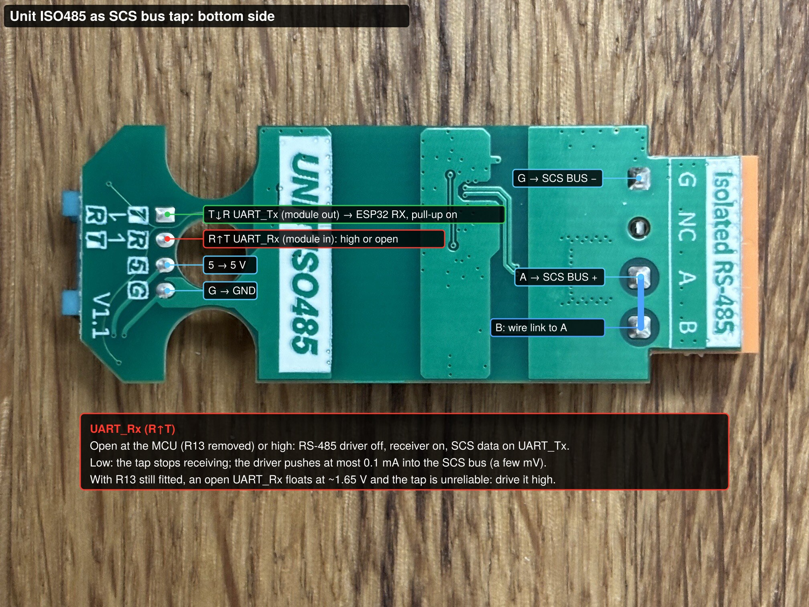

# Bticino SCS Bus Sniffer

Our building complex has an intercom from Bticino (Legrand).
Even though we were provisioned in 2021, we're on a proprietary, 2-wire bus called [SCS](https://en.wikipedia.org/wiki/Bus_SCS).
We are interested in logging some basic events, such as "which unit opened the garage door".

## Hardware

Because I was lazy, I decided to reuse some existing isolated RS-485 converter (even though SCS is very different from RS-485).
So this project takes the M5Stack's RS485-ISO ([`U094`](https://docs.m5stack.com/en/unit/Unit_RS485-ISO)) and adapts it for passive SCS sniffing.

SCS is a 27 V DC bus that carries power and data on the same two wires.
Data is UART-like (9600 Bd, 8N1), but a `0` bit is only a ~6 V dip lasting 34 µs at the start of the 104 µs bit cell; idle and `1` bits leave the bus alone.
The RS-485 receiver is just a differential comparator, so both of its inputs are fed from the same bus wire through two voltage dividers:
`A` follows the bus quickly (33k/4.7k, τ ≈ 9 µs), while `B` sits at a slightly lower ratio (36k/4.7k) behind a 10 µF capacitor, i.e., it tracks the average bus voltage over ~40 ms.
At idle, `A` is ~0.25 V above `B` and the receiver outputs high; during a dip, `A` drops ~0.5 V below `B` and the output goes low.
The threshold therefore follows whatever voltage the bus happens to sit at.
The transceiver's isolation barrier and its isolated DC/DC converter keep the MCU galvanically separate from the bus, and the 33k/36k series resistors limit the load to ~1.5 mA, so the tap cannot disturb the bus even if the RS-485 driver gets enabled.
The MCU receives the raw 34 µs pulses on the Grove port and decodes them with the ESP32's RMT peripheral.

### Schematic

The original M5Stack schematic with the modifications drawn in ([PDF](docs/schematic.pdf)):

### Board, top side

### Board, bottom side

